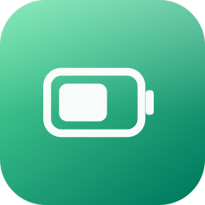
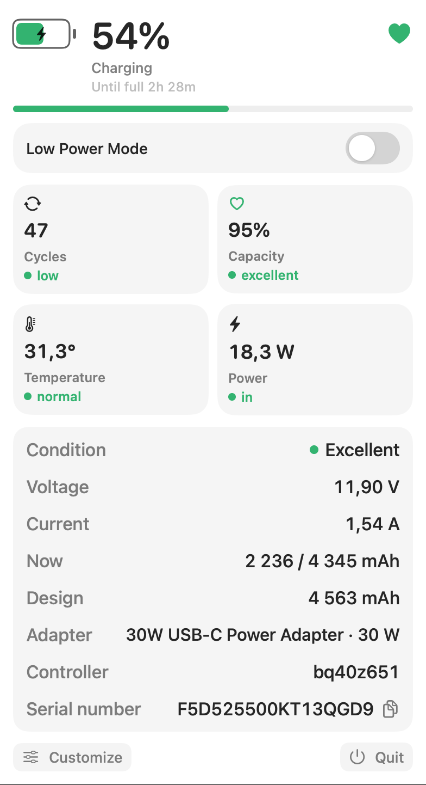
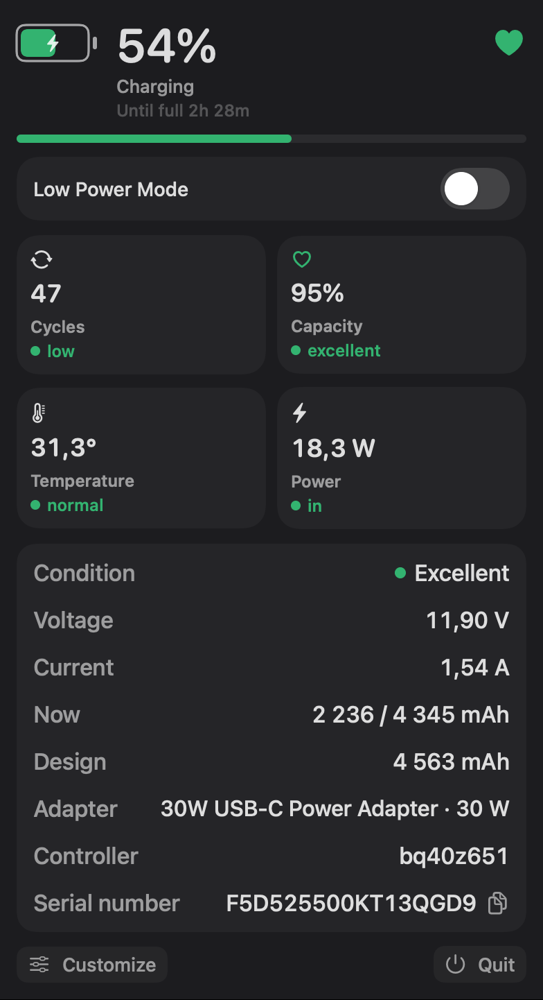
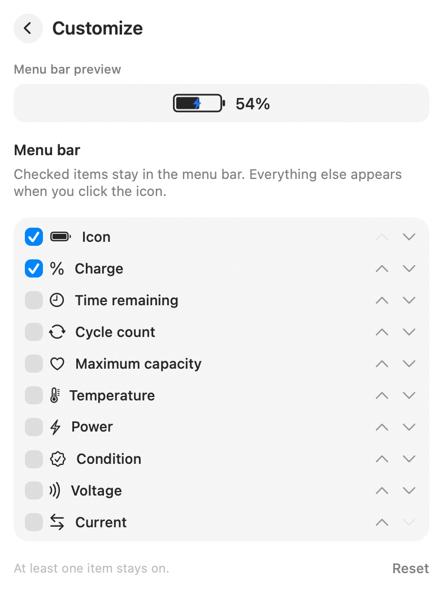

**English** | [Русский](README.ru.md)

<p align="center">
  
</p>

<h1 align="center">Battery Info</h1>

<p align="center">
  A menu-bar battery app for Mac. Charge, cycles, health, temperature, and power stay visible, instead of hiding behind the system battery icon.
</p>

<p align="center">
  <a href="https://github.com/strdns/Battery-Info/releases/latest">
    
  </a>
</p>

Battery Info lives in the menu bar, in the slot where the system battery icon usually sits, between Wi‑Fi and Control Center. Click it for the full picture. The interface follows the system language: Russian when Russian is preferred, English otherwise.

<p align="center">
  
</p>

## Menu bar

The tray battery keeps one size. At a normal charge it uses the menu-bar label color. At 20% or below it turns red, in the tray and in the panel.

| On battery | Charging | 20% or below | Low Power Mode |
| --- | --- | --- | --- |
|  |  |  |  |

- On battery, the percent is drawn inside the icon, without an outline.
- While charging, or when charging is paused, a blue bolt is drawn on the battery and the percent sits beside it. The panel text says **Charging** or **Charging paused**.
- Low Power Mode adds a green leaf in the tray and in the panel.
- Choose what else stays in the tray. Everything you leave off is still there when you click the icon.

The panel stays where you opened it while you turn tray items on and off, so the menu does not jump as the icon changes width. The tray itself updates immediately.

## The panel

The header shows the charge, time remaining or time until full, and a mark in the top-right corner. That mark follows **Condition**, not maximum capacity:

| Condition | Mark |
| --- | --- |
| Excellent | Green filled heart |
| Normal | Green heart outline |
| Fair | Yellow heart |
| Service recommended | Red wrench |
| Unknown | Red circle |

Four cards sit under the charge bar. The name stays one color. The state is a colored word under it, with a dot of the same color.

- **Cycles** — the count, then low (under 300, green), moderate (300–699, yellow), or high (700 or more, red).
- **Capacity** — maximum capacity against the design capacity: new (99–100%), excellent (95–98%), good (85–94%), fair (80–84%), poor (70–79%), critical (under 70%). The heart on the card matches the grade.
- **Temperature** — normal at 40°C or below, high above that.
- **Power** — in while the battery is taking a charge, out while it is supplying one.

If cycles, capacity, temperature, or power cannot be read, the value is a dash and the state says **Unknown** next to a red dot.

The table underneath lists condition, voltage, current, the current and design capacity in mAh, the adapter, the controller, and the serial number. The serial number can be copied.

Low Power Mode is a switch in the panel. The first change in a launch may ask for an administrator password. Later changes in the same launch do not.

<p align="center">
  
</p>

## Customize

Open **Customize** to pick the tray, reorder it, and turn on launch at login. Checked rows stay in the menu bar. The rest appear only in the panel.

<p align="center">
  
</p>

Right-click the menu-bar icon for Open, Customize, and Quit. Quitting puts the system battery icon back.

## Install

[Download the latest release](https://github.com/denstrelnikov/Battery-Info/releases/latest), open `Battery.Info.dmg`, and drag **Battery Info** onto the Applications folder. Open the app from Applications. It has no Dock icon: it appears in the menu bar.

### First launch

macOS says the app is not safe and offers to delete it (Move to Trash). Do not delete it.

Open **System Settings → Privacy & Security** and choose **Open Anyway**. macOS asks once more to confirm. After that the app opens as usual.

## Requirements

- macOS 14 or later

To build the disk image yourself, install the [Xcode Command Line Tools](https://developer.apple.com/xcode/resources/) (`xcode-select --install`) and run:

```sh
./build.sh
```

The script builds the app, writes `dist/Battery Info.dmg`, installs the app to `~/Applications/Battery Info.app`, and launches it. The app can also open again at login.
