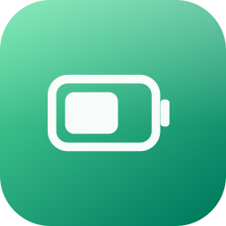
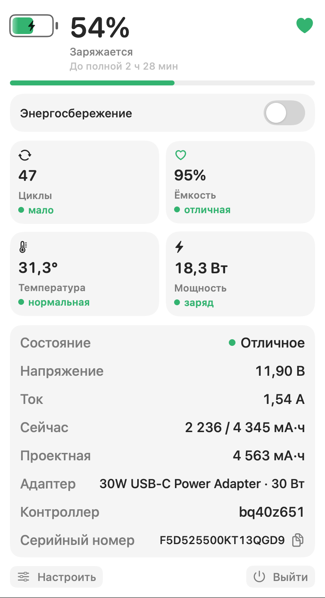
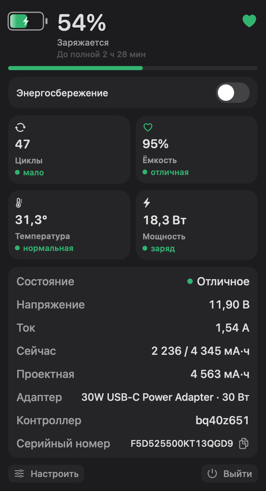
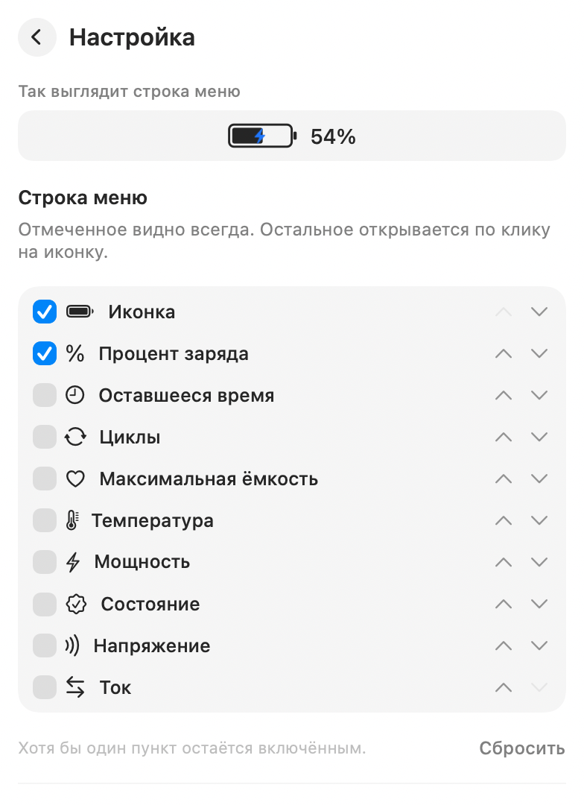

[English](README.md) | **Русский**

<p align="center">
  
</p>

<h1 align="center">Battery Info</h1>

<p align="center">
  Приложение батареи для строки меню macOS. Заряд, циклы, ёмкость, температура и мощность видны сразу, а не спрятаны за системным значком.
</p>

<p align="center">
  <a href="https://github.com/denstrelnikov/Battery-Info/releases/latest">
    
  </a>
</p>

Battery Info стоит в строке меню на месте системной батареи, между Wi‑Fi и Пунктом управления. По клику открывается полная панель. Язык берётся из системы: русский, если он предпочтительный, иначе английский.

<p align="center">
  
</p>

## Строка меню

Батарея в трее не меняет размер. При обычном заряде она цвета подписи строки меню. При 20% и ниже она красная и в трее, и в панели.

| От батареи | Зарядка | 20% и ниже | Энергосбережение |
| --- | --- | --- | --- |
|  |  |  |  |

- От батареи процент нарисован внутри значка, без обводки.
- Пока батарея заряжается или зарядка приостановлена, на значке синяя молния, а процент стоит рядом. В панели при этом написано **Заряжается** или **Зарядка приостановлена**.
- В режиме энергосбережения рядом с батареей и в панели появляется зелёный лист.
- Можно выбрать, что ещё остаётся в трее. Остальное видно по клику на значок.

Пока панель открыта, она не уезжает, когда ширина значка меняется. Сам трей обновляется сразу.

## Панель

В шапке заряд, оставшееся время или время до полной зарядки и значок справа сверху. Он следует строке **Состояние**, а не максимальной ёмкости:

| Состояние | Значок |
| --- | --- |
| Отличное | Зелёное заполненное сердечко |
| Нормальное | Зелёное сердечко контуром |
| Пониженное | Жёлтое сердечко |
| Нужно обслуживание | Красный гаечный ключ |
| Неопределено | Красный кружок |

Под полоской заряда четыре карточки. Название всегда одного цвета. Состояние написано под ним цветным словом и точкой того же цвета.

- **Циклы** — число, затем мало (меньше 300, зелёный), среднее (300–699, жёлтый) или много (700 и больше, красный).
- **Ёмкость** — максимальная ёмкость относительно проектной: новая (99–100%), отличная (95–98%), хорошая (85–94%), средняя (80–84%), плохая (70–79%), критическая (меньше 70%). Сердечко на карточке совпадает с оценкой.
- **Температура** — нормальная при 40°C и ниже, высокая выше.
- **Мощность** — заряд, когда батарея принимает ток, и разряд, когда отдаёт.

Если циклы, ёмкость, температуру или мощность прочитать не удалось, вместо числа стоит прочерк, а в состоянии написано **Неопределено** рядом с красной точкой.

Ниже таблица: состояние, напряжение, ток, текущая и проектная ёмкость в мА·ч, адаптер, контроллер и серийный номер. Серийный номер можно скопировать.

Энергосбережение включается переключателем в панели. Первый раз за запуск система может спросить пароль администратора. Следующие переключения в этом запуске проходят без запроса.

<p align="center">
  
</p>

## Настройка

**Настроить** открывает выбор пунктов трея, их порядок и запуск при входе. Отмеченное остаётся в строке меню. Остальное видно только в панели.

<p align="center">
  
</p>

Правый клик по значку в строке меню открывает пункты «Открыть», «Настроить…» и «Выйти». После выхода системный значок батареи возвращается.

## Установка

[Скачайте последний релиз](https://github.com/denstrelnikov/Battery-Info/releases/latest), откройте `Battery Info.dmg` и перетащите **Battery Info** в папку «Программы». Затем откройте приложение оттуда. Значка в Dock нет: оно появляется в строке меню.

### Первый запуск

macOS напишет, что приложение небезопасно, и предложит удалить его (переместить в Корзину). Удалять не нужно.

Откройте **Системные настройки → Конфиденциальность и безопасность** и нажмите **Все равно открыть**. Система спросит подтверждение ещё раз. После этого приложение открывается как обычно.

## Требования

- macOS 14 или новее

Чтобы собрать образ самостоятельно, поставьте [инструменты командной строки Xcode](https://developer.apple.com/xcode/resources/) (`xcode-select --install`) и выполните:

```sh
./build.sh
```

Скрипт собирает приложение, записывает `dist/Battery Info.dmg`, ставит приложение в `~/Applications/Battery Info.app` и запускает его. Приложение также может открываться при входе в систему.
